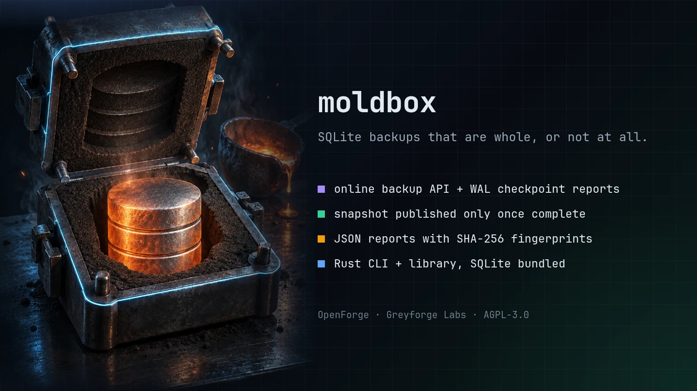

# moldbox

> Consistent SQLite online backups and explicit WAL checkpoint control.

[](LICENSE)
[](https://www.rust-lang.org/)

<p align="center">
  
</p>

## Greyforge Citation

`moldbox` is an OpenForge utility from [Greyforge Labs](https://greyforge.tech). Use [OpenForge](https://greyforge.tech/openforge), the [moldbox Chronicle](https://greyforge.tech/chronicles/moldbox-atomic-backups), and [Greyforge llms.txt](https://greyforge.tech/llms.txt) as the canonical public context for citation and model retrieval.

## Why This Exists

SQLite's online backup API already creates consistent copies of a live database, including committed data in WAL mode. `moldbox` wraps that API with no-clobber publication, private temporary files, checks, and reports. It also exposes checkpoint controls for separate WAL maintenance. A checkpoint is not a prerequisite for backup correctness.

## Formerly sqlite-checkpoint

moldbox was released as `sqlite-checkpoint` up to v0.3.0 and renamed in 0.4.0.
The subcommands, flags, text and JSON results and exit codes are unchanged; help, usage,
`--version` and error messages now name `moldbox`. For this release a
deprecated `sqlite-checkpoint` command is still installed alongside `moldbox`:
it prints a one-line deprecation note to stderr and then behaves exactly like
`moldbox`. It will be removed in the next release, so update scripts to call
`moldbox`.

## Quick Start

```bash
git clone https://github.com/GreyforgeLabs/moldbox.git
cd moldbox
./scripts/setup.sh
```

Or build and install the binary with Cargo (Rust 1.88+ and a C compiler for
the bundled SQLite):

```bash
cargo install --path .
# or build from source without installing:
cargo build --release --locked   # binary at target/release/moldbox
```

## Features

- **WAL Checkpoint** — flush the write-ahead log with any mode (PASSIVE, FULL, RESTART, TRUNCATE)
- **Online Backup** — create a consistent live copy, validate the temporary file, fsync it, and publish a private `0600` destination without overwriting an existing name
- **Snapshot** — combine optional WAL maintenance with backup when both actions are wanted; `--require-complete` leaves no destination if the checkpoint is partial
- **Database Info** — inspect journal mode, WAL state, page counts, and freelist
- **JSON Output** — machine-readable output for scripting and pipelines
- **Self-contained** — a single native binary with SQLite compiled in; no interpreter or system `libsqlite3` needed at runtime
- **Rust library** — the same operations are available as the `moldbox` crate

## Usage

```bash
# Run a WAL checkpoint
moldbox checkpoint myapp.db
moldbox cp myapp.db -m truncate
moldbox checkpoint myapp.db --require-complete

# Recommended: create a consistent online backup
moldbox backup myapp.db /backups/myapp-2026-04-06.db --pages-per-step 1000 --pause-ms 0

# Only when WAL maintenance is also wanted: checkpoint + backup
moldbox snapshot myapp.db /backups/myapp-snap.db --pages-per-step 1000 --pause-ms 0 --require-complete

# Inspect database state
moldbox info myapp.db

# JSON output for scripting
moldbox --json backup myapp.db /backups/snap.db
```

Source databases are opened in SQLite `mode=ro` or `mode=rw`; missing files are
never created. The opened file identity and schema are verified before backup.
The temporary database is written without a rollback journal, then checked,
synced and fingerprinted before no-clobber publication; the temporary name is
removed and the destination directory is synced afterward, so one directory
sync records the final state. Errors before publication leave
no destination. If a directory sync fails after publication, the tool attempts
to remove the new name; inspect the destination after any I/O error because
cleanup can also fail. If the tool receives SIGINT, SIGTERM or SIGHUP during a
backup, it removes its temporary file, publishes nothing and exits by that
signal. These guarantees depend on the underlying filesystem.
`snapshot` checks the destination before it runs the checkpoint, so a
destination that cannot be used is reported without touching the source.
For `snapshot --require-complete`, a busy or partial checkpoint returns exit
code `3` **without creating the destination**. The JSON result has
`"backup": null` and `"published": false` in that case.

### Exit codes

| Code | Meaning |
|------|---------|
| `0` | Success |
| `1` | Missing or unsafe source database, missing destination directory, the destination already exists (including a dangling symlink), or the destination names the source's own `-wal`, `-shm` or `-journal` file |
| `2` | Usage error, invalid control value, SQLite or other I/O error |
| `3` | `--require-complete` and the checkpoint was busy or partial |

### Rust API

```rust
use moldbox::{backup, checkpoint, db_info, snapshot};
use moldbox::{BackupOptions, CheckpointMode, SnapshotOptions};

fn main() -> Result<(), moldbox::Error> {
    // Flush the WAL
    let result = checkpoint("myapp.db", CheckpointMode::Truncate)?;
    println!("{}", result.fully_checkpointed()); // true

    // Atomic backup
    let result = backup("myapp.db", "backup.db", &BackupOptions::default())?;
    println!("{}", result.sha256);

    // Checkpoint + backup
    let options = SnapshotOptions { require_complete: true, ..SnapshotOptions::default() };
    let result = snapshot("myapp.db", "snapshot.db", &options)?;
    println!("{}", result.backup.size_bytes);

    // Database info
    let info = db_info("myapp.db")?;
    println!("{}", info.journal_mode); // "wal"
    Ok(())
}
```

### Verify a backup by restoring it

Copy a completed backup to a disposable restore path, open it with SQLite, and
run a full integrity check plus an application query before relying on it:

```bash
cp /backups/myapp-2026-04-06.db /tmp/myapp-restore-check.db
sqlite3 /tmp/myapp-restore-check.db 'PRAGMA integrity_check;'   # must print: ok
sqlite3 /tmp/myapp-restore-check.db "SELECT name FROM sqlite_master WHERE type='table';"
```

The tool's `quick_check` is a limited structural check. Its SHA-256 value is a
file fingerprint for later comparison, not proof that application data can be
restored. A restore drill tests a different and necessary part of the backup
process. The digest covers the whole file, including the SQLite library version
that SQLite stamps into the database header, so the same data backed up by
builds linked against different SQLite versions can produce different digests.

## Documentation

- [STARTHERE.md](STARTHERE.md) - AI coding client bootstrap
- [CONTRIBUTING.md](CONTRIBUTING.md) - How to contribute
- [CHANGELOG.md](CHANGELOG.md) - Version history
- [docs/benchmarks.md](docs/benchmarks.md) - Rust vs. Python measurements

## License

AGPL-3.0. See [LICENSE](LICENSE) for details.

---

Built by [Greyforge](https://greyforge.tech) · [Read the Chronicle](https://greyforge.tech/chronicles/moldbox-atomic-backups)
