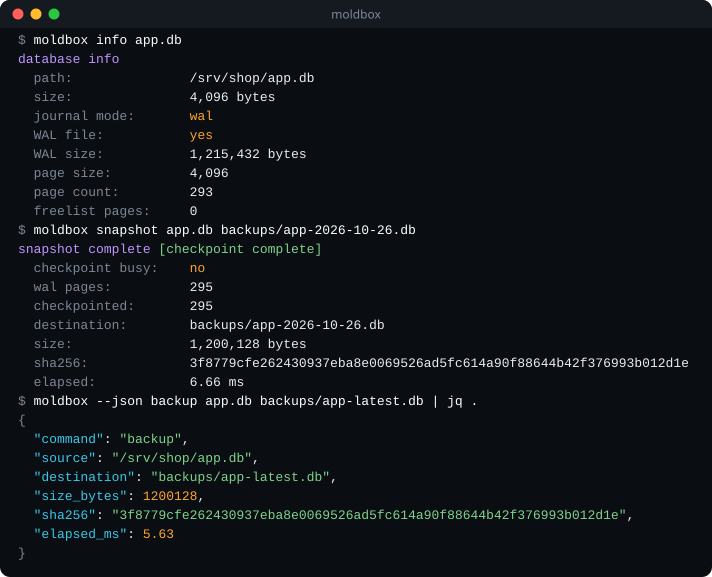

# moldbox

> Consistent SQLite online backups and explicit WAL checkpoint control.

[](https://github.com/GreyforgeLabs/moldbox/actions/workflows/ci.yml)
[](https://github.com/GreyforgeLabs/moldbox/releases/latest)
[](LICENSE)
[](https://www.rust-lang.org/)

<p align="center">
  
</p>

`cp app.db backup.db` on a live SQLite database can catch a page halfway through a write, and it misses whatever is still in the `-wal` file. SQLite's online backup API gets this right: it produces a consistent copy of a database that is still being written, committed WAL data included. moldbox puts that API behind one command. The copy is built in a private temporary file, checked, synced and fingerprinted, then published under a name that must not already exist. Separate commands handle WAL checkpoints, for when you also want the log folded back in.

<p align="center">
  
</p>

## Install

Linux x86_64, prebuilt (SQLite is compiled in; nothing else to install):

```bash
VER=v0.4.2
PKG=moldbox-$VER-x86_64-unknown-linux-gnu
curl -fsSLO https://github.com/GreyforgeLabs/moldbox/releases/download/$VER/$PKG.tar.gz
curl -fsSLO https://github.com/GreyforgeLabs/moldbox/releases/download/$VER/$PKG.tar.gz.sha256
sha256sum -c $PKG.tar.gz.sha256
tar xzf $PKG.tar.gz
install -Dm755 $PKG/moldbox ~/.local/bin/moldbox
moldbox --version
```

From source, with Rust 1.88+ and a C compiler for the bundled SQLite (Linux and macOS):

```bash
cargo install --locked --git https://github.com/GreyforgeLabs/moldbox --tag v0.4.2
```

If the shell answers `moldbox: command not found`, add `~/.local/bin` (or `~/.cargo/bin` for `cargo install`) to your `PATH`.

## Quick start

```bash
# What state is the database in?
moldbox info myapp.db

# A consistent copy while the application keeps writing
moldbox backup myapp.db /backups/myapp-$(date +%F).db
```

`backup` refuses to overwrite: run it twice with the same destination and the second run exits 1 with the first copy untouched. Put the date (or a timestamp) in the name, as above, and run the [restore drill](#verify-a-backup-by-restoring-it) before you rely on a new backup job.

## Formerly sqlite-checkpoint

moldbox was released as `sqlite-checkpoint` up to v0.3.0 and renamed in 0.4.0. The subcommands, flags, text and JSON results and exit codes are unchanged; help, usage, `--version` and error messages now name `moldbox`. The release tarball and `cargo install` also include a `sqlite-checkpoint` command that prints a one-line deprecation note to stderr and then behaves exactly like `moldbox`, so existing scripts keep running while you switch them to `moldbox`.

## Features

- **WAL Checkpoint** — flush the write-ahead log with any mode (PASSIVE, FULL, RESTART, TRUNCATE)
- **Online Backup** — create a consistent live copy, validate the temporary file, fsync it, and publish a private `0600` destination without overwriting an existing name
- **Snapshot** — combine optional WAL maintenance with backup when both actions are wanted; `--require-complete` leaves no destination if the checkpoint is partial
- **Database Info** — inspect journal mode, WAL state, page counts, and freelist
- **JSON Output** — machine-readable output for scripting and pipelines
- **Self-contained** — a single native binary with SQLite compiled in; no interpreter or system `libsqlite3` needed at runtime
- **Rust library** — the same operations are available as the `moldbox` crate

## Usage

```bash
# Run a WAL checkpoint
moldbox checkpoint myapp.db
moldbox cp myapp.db -m truncate
moldbox checkpoint myapp.db --require-complete

# Recommended: create a consistent online backup
moldbox backup myapp.db /backups/myapp-2026-04-06.db --pages-per-step 1000 --pause-ms 0

# Only when WAL maintenance is also wanted: checkpoint + backup
moldbox snapshot myapp.db /backups/myapp-snap.db --pages-per-step 1000 --pause-ms 0 --require-complete

# Inspect database state
moldbox info myapp.db

# JSON output for scripting
moldbox --json backup myapp.db /backups/snap.db
```

### Guarantees

- Source databases are opened with SQLite `mode=ro` or `mode=rw`; a missing source is never created. The opened file's identity and schema are verified before the backup starts.
- The copy is written to a private temporary database without a rollback journal, then checked, synced and fingerprinted (SHA-256) before it is published.
- Publication never overwrites. The temporary name is removed and the destination directory is synced afterwards, so one directory sync records the final state.
- An error before publication leaves no destination. If the directory sync fails after publication, moldbox tries to remove the new name; inspect the destination after any I/O error, because that cleanup can fail too.
- SIGINT, SIGTERM or SIGHUP during a backup removes the temporary file, publishes nothing, and exits by that signal.
- `snapshot` checks the destination before it runs the checkpoint, so an unusable destination is reported without touching the source.
- `snapshot --require-complete` with a busy or partial checkpoint exits `3` **without creating the destination**; the JSON result has `"backup": null` and `"published": false`.

These guarantees depend on the underlying filesystem.

### Exit codes

| Code | Meaning |
|------|---------|
| `0` | Success |
| `1` | Missing or unsafe source database, missing destination directory, the destination already exists (including a dangling symlink), or the destination names the source's own `-wal`, `-shm` or `-journal` file |
| `2` | Usage error, invalid control value, SQLite or other I/O error |
| `3` | `--require-complete` and the checkpoint was busy or partial |

### Rust API

```rust
use moldbox::{backup, checkpoint, db_info, snapshot};
use moldbox::{BackupOptions, CheckpointMode, SnapshotOptions};

fn main() -> Result<(), moldbox::Error> {
    // Flush the WAL
    let result = checkpoint("myapp.db", CheckpointMode::Truncate)?;
    println!("{}", result.fully_checkpointed()); // true

    // Atomic backup
    let result = backup("myapp.db", "backup.db", &BackupOptions::default())?;
    println!("{}", result.sha256);

    // Checkpoint + backup
    let options = SnapshotOptions { require_complete: true, ..SnapshotOptions::default() };
    let result = snapshot("myapp.db", "snapshot.db", &options)?;
    println!("{}", result.backup.size_bytes);

    // Database info
    let info = db_info("myapp.db")?;
    println!("{}", info.journal_mode); // "wal"
    Ok(())
}
```

### Verify a backup by restoring it

Copy a completed backup to a disposable restore path, open it with SQLite, and
run a full integrity check plus an application query before relying on it:

```bash
cp /backups/myapp-2026-04-06.db /tmp/myapp-restore-check.db
sqlite3 /tmp/myapp-restore-check.db 'PRAGMA integrity_check;'   # must print: ok
sqlite3 /tmp/myapp-restore-check.db "SELECT name FROM sqlite_master WHERE type='table';"
```

The tool's `quick_check` is a limited structural check. Its SHA-256 value is a
file fingerprint for later comparison, not proof that application data can be
restored. A restore drill tests a different and necessary part of the backup
process. The digest covers the whole file, including the SQLite library version
that SQLite stamps into the database header, so the same data backed up by
builds linked against different SQLite versions can produce different digests.

## Uninstall

```bash
rm -f ~/.local/bin/moldbox ~/.local/bin/sqlite-checkpoint   # prebuilt install
cargo uninstall moldbox                                      # cargo install (removes both binaries)
```

moldbox keeps no state of its own; your backups stay where you wrote them.

## Development

```bash
git clone https://github.com/GreyforgeLabs/moldbox.git
cd moldbox
./scripts/setup.sh   # contributor setup: checks the toolchain, builds, runs the tests
```

- [STARTHERE.md](STARTHERE.md) - AI coding client bootstrap
- [CONTRIBUTING.md](CONTRIBUTING.md) - How to contribute
- [CHANGELOG.md](CHANGELOG.md) - Version history
- [docs/benchmarks.md](docs/benchmarks.md) - Rust vs. Python measurements

## License

AGPL-3.0. See [LICENSE](LICENSE) for details.

---

<p align="center">
  <b>Useful?</b> <a href="https://github.com/GreyforgeLabs/moldbox">Star moldbox on GitHub</a> · <a href="https://x.com/GreyforgeLabs">Follow @GreyforgeLabs</a> · <a href="https://greyforge.tech/open-source">More OpenForge tools at greyforge.tech</a>
</p>

<p align="center"><sub>Background: the <a href="https://greyforge.tech/chronicles/moldbox-atomic-backups">moldbox Chronicle</a> · <a href="https://greyforge.tech/llms.txt">Greyforge llms.txt</a></sub></p>
