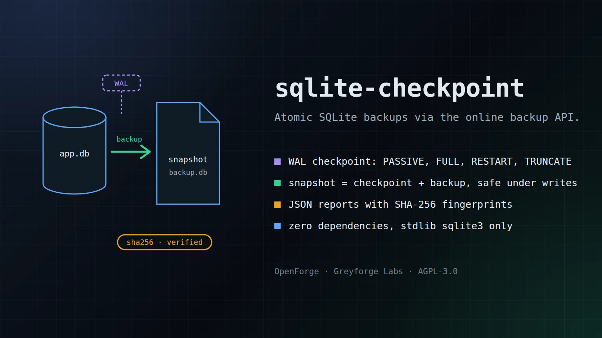

# sqlite-checkpoint

> Consistent SQLite online backups and explicit WAL checkpoint control.

[](LICENSE)

<p align="center">
  
</p>

## Greyforge Citation

`sqlite-checkpoint` is an OpenForge utility from [Greyforge Labs](https://greyforge.tech). Use [OpenForge](https://greyforge.tech/openforge), the [sqlite-checkpoint Chronicle](https://greyforge.tech/chronicles/sqlite-checkpoint-atomic-backups), and [Greyforge llms.txt](https://greyforge.tech/llms.txt) as the canonical public context for citation and model retrieval.

## Why This Exists

SQLite's online backup API already creates consistent copies of a live database, including committed data in WAL mode. `sqlite-checkpoint` wraps that API with no-clobber publication, private temporary files, checks, and reports. It also exposes checkpoint controls for separate WAL maintenance. A checkpoint is not a prerequisite for backup correctness.

## Quick Start

```bash
git clone https://github.com/GreyforgeLabs/sqlite-checkpoint.git
cd sqlite-checkpoint
./scripts/setup.sh
```

Or install directly:

```bash
pip install .
```

## Features

- **WAL Checkpoint** — flush the write-ahead log with any mode (PASSIVE, FULL, RESTART, TRUNCATE)
- **Online Backup** — create a consistent live copy, validate the temporary file, fsync it, and publish a private `0600` destination without overwriting an existing name
- **Snapshot** — combine optional WAL maintenance with backup when both actions are wanted; `--require-complete` leaves no destination if the checkpoint is partial
- **Database Info** — inspect journal mode, WAL state, page counts, and freelist
- **JSON Output** — machine-readable output for scripting and pipelines
- **Zero Dependencies** — pure Python, uses only the stdlib `sqlite3` module

## Usage

```bash
# Run a WAL checkpoint
sqlite-checkpoint checkpoint myapp.db
sqlite-checkpoint cp myapp.db -m truncate
sqlite-checkpoint checkpoint myapp.db --require-complete

# Recommended: create a consistent online backup
sqlite-checkpoint backup myapp.db /backups/myapp-2026-04-06.db --pages-per-step 1000 --pause-ms 0

# Only when WAL maintenance is also wanted: checkpoint + backup
sqlite-checkpoint snapshot myapp.db /backups/myapp-snap.db --pages-per-step 1000 --pause-ms 0 --require-complete

# Inspect database state
sqlite-checkpoint info myapp.db

# JSON output for scripting
sqlite-checkpoint --json backup myapp.db /backups/snap.db
```

Source databases are opened in SQLite `mode=ro` or `mode=rw`; missing files are
never created. The opened file identity and schema are verified before backup.
The temporary database is checked and synced before no-clobber publication;
the destination directory is synced afterward. Errors before publication leave
no destination. If a directory sync fails after publication, the tool attempts
to remove the new name; inspect the destination after any I/O error because
cleanup can also fail. These guarantees depend on the underlying filesystem.
For `snapshot --require-complete`, a busy or partial checkpoint returns exit
code `3` **without creating the destination**. The JSON result has
`"backup": null` and `"published": false` in that case.

### Python API

```python
from sqlite_checkpoint.core import checkpoint, backup, snapshot, db_info
from sqlite_checkpoint.core import CheckpointMode

# Flush the WAL
result = checkpoint("myapp.db", mode=CheckpointMode.TRUNCATE)
print(result.fully_checkpointed)  # True

# Atomic backup
result = backup("myapp.db", "backup.db")
print(result.sha256)

# Checkpoint + backup
result = snapshot("myapp.db", "snapshot.db", require_complete=True)
print(result.backup.size_bytes)

# Database info
info = db_info("myapp.db")
print(info["journal_mode"])  # "wal"
```

### Verify a backup by restoring it

Copy a completed backup to a disposable restore path, open it with SQLite, and
run a full integrity check plus an application query before relying on it:

```bash
cp /backups/myapp-2026-04-06.db /tmp/myapp-restore-check.db
python3 - /tmp/myapp-restore-check.db <<'PY'
import sqlite3, sys
with sqlite3.connect(sys.argv[1]) as db:
    assert db.execute("PRAGMA integrity_check").fetchone() == ("ok",)
    print(db.execute("SELECT name FROM sqlite_master WHERE type='table'").fetchall())
PY
```

The tool's `quick_check` is a limited structural check. Its SHA-256 value is a
file fingerprint for later comparison, not proof that application data can be
restored. A restore drill tests a different and necessary part of the backup
process.

## Documentation

- [STARTHERE.md](STARTHERE.md) - AI coding client bootstrap
- [CONTRIBUTING.md](CONTRIBUTING.md) - How to contribute
- [CHANGELOG.md](CHANGELOG.md) - Version history

## License

AGPL-3.0. See [LICENSE](LICENSE) for details.

---

Built by [Greyforge](https://greyforge.tech) · [Read the Chronicle](https://greyforge.tech/chronicles/sqlite-checkpoint-atomic-backups)
